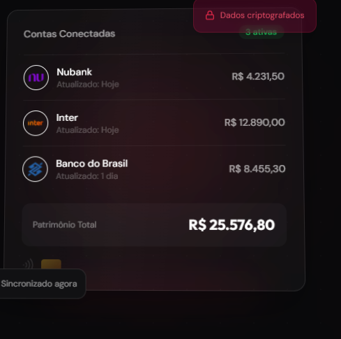

# NxusLife — próximos passos (não iniciados)

## Melhorar a interface
O visual atual ainda não agrada por completo. Referência desejada para o cartão de contas:

- Logo de cada banco, saldo por banco e "Atualizado: hoje".
- Patrimônio total em destaque.
- Selo "Dados criptografados" e indicação "Sincronizado agora".

## Sincronizar bancos pelo Open Finance (Pluggy, plano gratuito pessoal) — feito na 2.1.0
Serviço em `server/pluggy-proxy/` (na VM) e app em `data/sync/`. Falta o cartão do Sicoob (refazer a autorização no Meu Pluggy incluindo cartão).

1. Criar conta no [Meu Pluggy](https://meu.pluggy.ai) e conectar Nubank e Sicoob (confirmar se o Sicoob está disponível).
2. Criar um app de desenvolvedor no painel do Pluggy e vinculá-lo ao Meu Pluggy (uma autorização por banco; dados atualizados 1×/dia).
3. **O Client Secret fica só na VM** (serviço pequeno que busca os dados no Pluggy); o app conversa apenas com a VM, protegido por chave própria. Nunca colocar o segredo no APK, que é público.
4. No app: tela de contas conectadas (referência acima), sugestão de lançamentos a partir das transações, sem duplicar o que já foi lançado.
